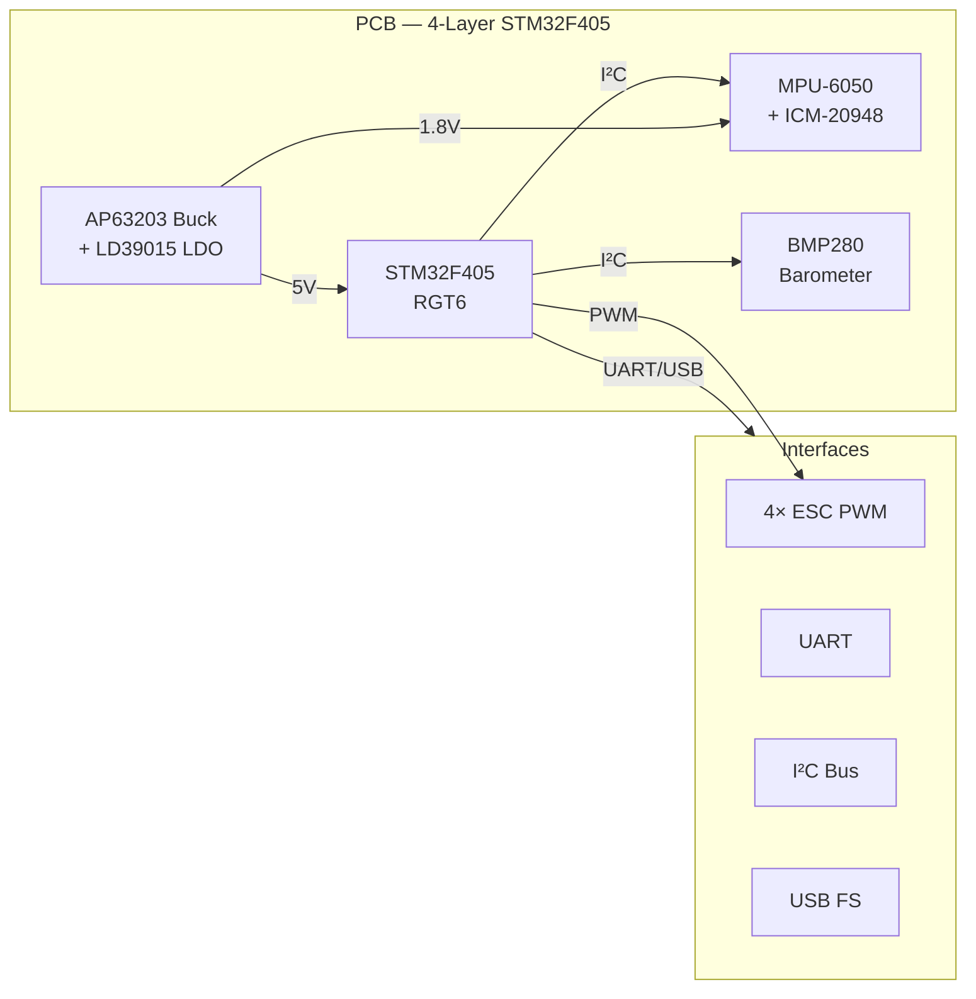

# Hermes Flight Controller


## Overview

This is a **custom STM32F405-based Flight Controller** designed for drone
applications. The PCB is designed in **KiCad** as a 4-layer board.

The hardware design is complete. PCB fabrication and firmware development are
the next steps — check back for updates.




## Quick Start

### Validate the design locally
```bash
# Run lint and tests
uv sync --group dev
uv run ruff check scripts/ tests/
uv run ruff format --check scripts/ tests/
uv run mypy scripts/
uv run pytest tests/ -v
```

### Review hardware files
```bash
# Schematic and layout PDFs are in PCB/
open PCB/Schematic-HermesFC.pdf
open PCB/PCB-HermesFC.pdf
```

### Order PCB from JLCPCB
1. Navigate to `PCB/HermesFC/manufacturing/`
2. Upload `HermesFC-Gerber.zip` to JLCPCB
3. Review BOM (`bom.csv`) and positions (`positions.csv`)


    MCU -->|I²C| IMU
    MCU -->|I²C| BARO
    PWR -->|5V| MCU
    PWR -->|1.8V| IMU
    MCU -->|PWM| ESC
    MCU -->|UART/USB| iface
```

## Features

- **Microcontroller:** STM32F405RGT6
- **IMU Sensors:** MPU-6050 and ICM-20948 (alternative footprints)
- **Barometer:** BMP280
- **Buck Converter:** AP63203 (5 V rail)
- **LDO Regulators:** LD39015M18R (1.8 V), USBLC6-2SC6 (USB ESD protection)
- **Level Shifter:** NTS0104PW (I2C voltage translation)
- **ESC Outputs:** 4× PWM channels
- **Communication Interfaces:** UART, I²C, USB (full-speed)
- **Crystal:** 16 MHz HSE oscillator
- **User Controls:** 2× tactile push-buttons, 2× status LEDs

## Hardware Design

### Schematic & PCB Layout


The full schematic and layout PDFs are available in the
[PCB/](PCB/) directory:

- [Schematic (PDF)](PCB/Schematic-HermesFC.pdf)
- [PCB Layout (PDF)](PCB/PCB-HermesFC.pdf)

### Manufacturing Files

Ready-to-order JLCPCB manufacturing files are located in
[`PCB/HermesFC/manufacturing/`](PCB/HermesFC/manufacturing/):

| File | Description |
| ------ | ----------- |
| `HermesFC-Gerber.zip` | Gerber files for PCB fabrication |
| `bom.csv` | Bill of Materials with LCSC part numbers |
| `positions.csv` | Component placement (pick-and-place) file |
| `netlist.ipc` | IPC-D-356 netlist for bare-board testing |

### Bill of Materials (summary)

| Ref | Component | LCSC # |
| ----- | --------- | ------ |
| U1 | STM32F405RGTx | C15742 |
| U2 | AP63203WU (buck converter) | C780769 |
| U3 | USBLC6-2SC6 (USB ESD) | C7519 |
| U4 | MPU-6050 (IMU) | C24112 |
| U5 | ICM-20948 (IMU alt.) | C726001 |
| U6 | LD39015M18R (1.8 V LDO) | C361025 |
| U7 | NTS0104PW (level shifter) | C2802637 |
| U8 | BMP280 (barometer) | C83291 |
| Y1 | 16 MHz crystal | C13738 |

## Repository Structure

```text
hermes-flightcontroller/
├── PCB/
│   ├── Datasheets/        # Component datasheets (PDF)
│   ├── Gallery/           # Rendered board and schematic images
│   ├── HermesFC/          # KiCad project files
│   │   ├── manufacturing/ # Gerber, BOM, and placement files
│   │   └── 3Dmodels/      # 3D models for footprints
│   ├── PCB-HermesFC.pdf
│   └── Schematic-HermesFC.pdf
└── README.md
```

## License

This project is open-source under the **MIT License**. See [LICENSE](LICENSE)
for details.

---

🚀 **Happy Flying!**
